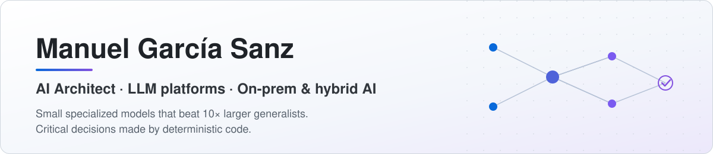

<picture>
  <source media="(prefers-color-scheme: dark)" srcset="assets/banner-dark.svg">
  
</picture>

  
  
  
  
  

## About me

Computer Engineer (UPV) with **15 years** building mission-critical, low-latency systems in **C++ and Linux**, most of them in contact-center and VoIP software, where an outage means calls dropping in real time. For six years I was the last escalation level: whatever broke in production (telephony, servers, performance, security) ended up on my desk.

Today I design and ship AI platforms **end to end**: data, fine-tuning, evaluation, optimized GPU inference and operations, on-prem, in the cloud or hybrid. I bring the systems background into it: native inference engines instead of Python glue, capacity and VRAM planning, measured latency, and software that keeps running when the GPU fails.

A hands-on architect: I decide on measured data (latency, cost, quality) and know what to automate, what a person should review and what data must never leave the client. My recurring pattern: **small specialized models that beat generalists 10× their size**, with the critical decisions made by deterministic code.

### Core expertise

- **C++ (expert, 15 years)**: modern C++20, multithreaded low-latency daemons, native single-binary tools for CPU and GPU, llama.cpp embedded as a library (continuous batching, admission control, SSE streaming), Qt, gRPC, REST and WebSockets, Asterisk modules.
- **Linux servers (expert)**: production administration and hardening, performance and scaling bottlenecks, incident response and security incidents on cloud fleets (AWS, OVH), systemd services, Docker, CI/CD.
- **AI platforms**: fine-tuning (full, LoRA, SFT, DPO, distillation), synthetic data, rigorous evaluation (frozen test sets, LLM-as-judge, execution scoring, statistical tests), GGUF quantization, GPU inference with CUDA and Vulkan, RAG, agents and MCP servers.
- **Real-time voice & telephony**: VoIP/SIP, Asterisk, FreeSWITCH; local speech-to-speech, speech-to-text and text-to-speech models.
- **Data**: PostgreSQL and MongoDB at high volume, pgvector, hybrid search, SQLCipher.
- **Leadership**: led teams of 6–15 people (development, systems and support), from analysis to production; the technical face for clients and management.

### Career

| Years | Role |
|---|---|
| 2025&nbsp;–&nbsp;now | **Founder & lead architect**, [FactuSight](https://factusight.com): local AI for invoice automation |
| 2023&nbsp;–&nbsp;now | **Senior Software Engineering Consultant, AI**, contact-center & VoIP software company |
| 2018&nbsp;–&nbsp;now | **Freelance software & AI consultant**: 30+ projects for 20+ clients |
| 2021&nbsp;–&nbsp;2022 | **Lead Backend Developer & Systems Architect**: architecture and coordination of the backend, systems and VoIP teams |
| 2014&nbsp;–&nbsp;2021 | **Technical Lead**: last escalation level for telephony and Linux cloud servers; team of 6–15 people |
| 2011&nbsp;–&nbsp;2014 | **C++ Software Developer**: Qt/C++, Asterisk modules, PostgreSQL and Linux |

## Open source

| Project | What it does | Measured result |
|---|---|---|
| [**dale**](https://github.com/manuelgscom/dale) | Natural language → Linux commands. 100% offline, one native C++ binary for CPU and GPU. | Fine-tuned **0.8B: 79.4%** vs 62.8% for Qwen3.5-9B on 471 cases; 1.7 s median on a 2020 laptop CPU. A deterministic shell analyzer catches 100% of 917 dangerous commands. |
| [**askmdb**](https://github.com/manuelgscom/askmdb) | Natural language → read-only MongoDB queries. 100% offline, native C++ binary. | Fine-tuned **0.8B: 83.6%** vs 47.8% for Qwen3.5-9B on 500 questions over 10 unseen databases, scored by execution. Read-only enforced by a BSON verifier, not by the model. |
| [**llama-server-native**](https://github.com/manuelgscom/llama-server-native) | llama.cpp's server compiled natively for your GPU in Docker, with private web search (SearXNG + MCP). | **2.5× more tokens/s** on a 27B model (5.7 → 14.5 tok/s on an RTX 5070 Ti) by tuning context, KV cache and VRAM. |

## Published models

All in GGUF on [huggingface.co/manuelgscom](https://huggingface.co/manuelgscom), with their benchmarks.

| Models | Task | Fine-tuned accuracy | Base model |
|---|---|---|---|
| dale · 0.8B · 2B · 4B · 9B | Natural language → bash | 79.4 · 81.7 · 87.0 · **89.2%** | Qwen3.5-9B: 62.8% |
| askmdb · 0.8B · 2B · 4B · 9B | Natural language → MongoDB | 83.6 · 86.8 · 89.6 · **91.6%** | Qwen3.5-9B: 47.8% |
| FactuSight · 2B · 4B · 9B (VLM) | Invoice image → 22 fields | 98.1 · 99.0 · **99.0%** per field | Qwen3.5-2B: 87.3% |

## What I build

- **[FactuSight](https://factusight.com)** (founder): local AI that reads Spanish invoices. Own vision-language models (LoRA on Qwen3.5), a native C++20 inference engine on llama.cpp (CUDA, Vulkan, CPU with automatic fallback), per-field confidence, human review and an encrypted database. No data leaves the machine.
- **On-prem RAG assistant for technical support**: hybrid search (pgvector + full text, RRF fusion), BGE-M3 embeddings, Qwen3 reranker and Qwen3.5-9B answering with cited sources. A C++ daemon with embedded llama.cpp, **continuous batching**, admission control, SSE streaming and its own **MCP server**; personal data (PII) anonymized at ingestion.
- **Local speech AI**: speech-to-speech, speech-to-text and text-to-speech models running on the client's own GPUs, plus VoIP/SIP integration (FreeSWITCH, Asterisk).
- **Agents with tools** over CRM, ERP and email; chatbots and voicebots with handoff to a human; private document automation down to the ERP.
- **30+ freelance projects for 20+ clients** since 2018: local open-weight models, cloud (OpenAI, Claude, Gemini, Azure OpenAI, AWS Bedrock in EU regions) or hybrid.

## Tech stack

**AI / LLM** 

**Languages & APIs** 

**Infra & data** 

## How I work

- **Measure everything that matters** (p50/p95 latency, VRAM, cost, quality) and publish the real results, negative ones included.
- **The AI proposes, deterministic code decides** what is critical: command and query verifiers, validation rules, human review of what is uncertain.
- **Architecture decisions written down before building**, with the discarded alternatives and why.
- **Multi-agent development** (Claude Code, Codex): parallel subagents per task, cross-model adversarial review and tests as the acceptance gate.

Computer Engineering · Universitat Politècnica de València · exchange at Eindhoven University of Technology

